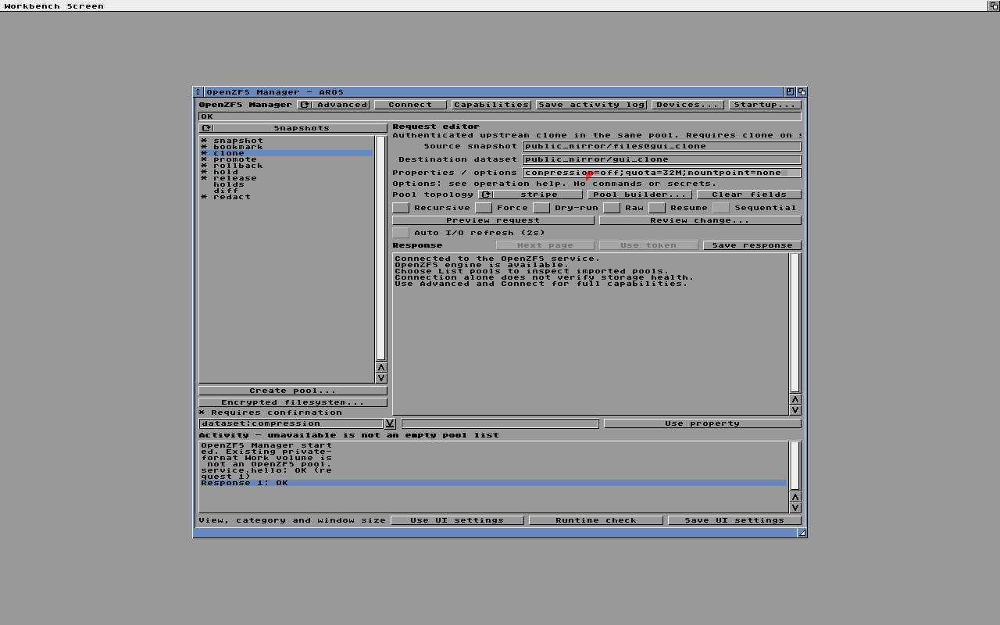
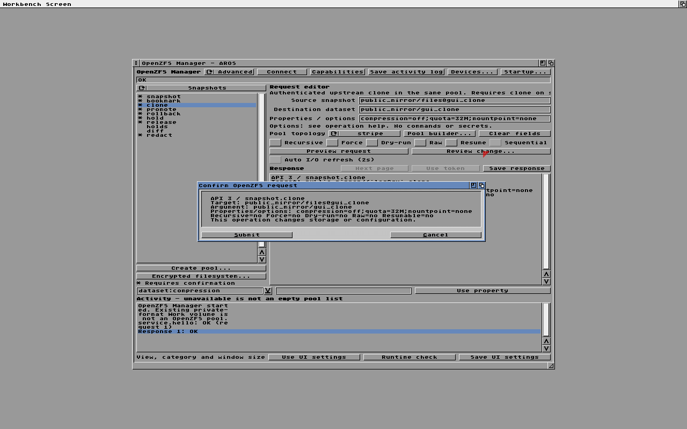
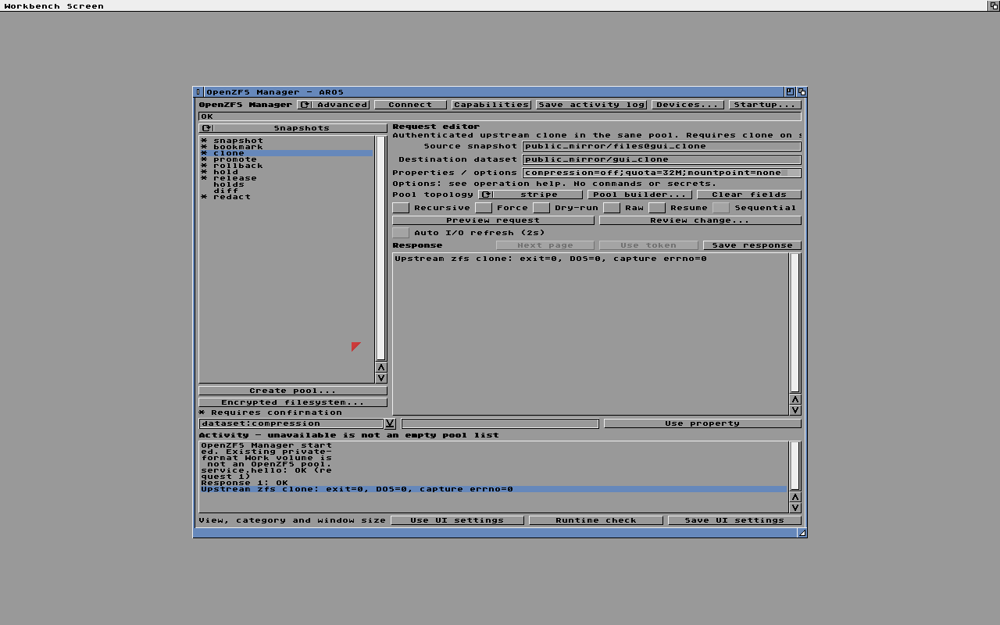
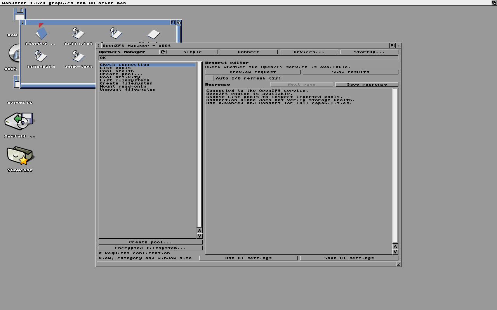
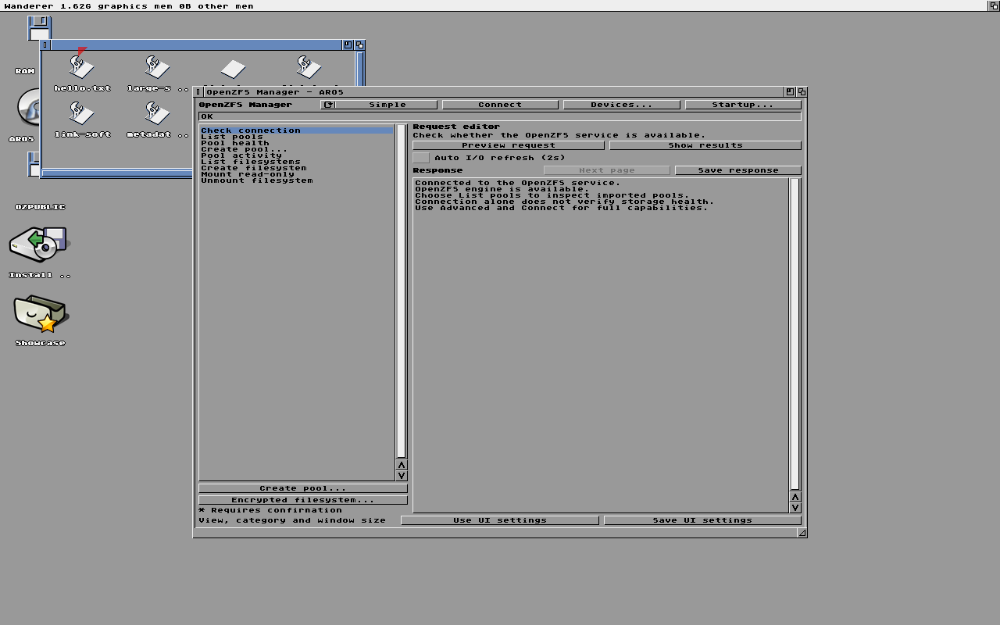

# Native AROS test screenshots

These are unmodified captures from isolated, two-CPU QEMU runs using disposable
storage and explicitly selected patched AROS runtime components. They are not
physical-device qualification or a claim of stock-nightly compatibility.

Each directory retains the serial log, source revision and working-tree patch,
input binary hashes, QEMU version, and ISO-pruning record from that same run.
Absolute paths in the manifests identify the original local inputs; the binary
images themselves are deliberately not stored in Git. A source revision alone
does not describe a run when `source.patch` is nonempty. See
[build and test details](../../../BUILDING.md) for the harness configuration.

## Clone properties through Manager

Run: `native-gui-run.A56TMiQN`. The request creates
`public_mirror/gui_clone` from `public_mirror/files@gui_clone` with
`compression=off;quota=32M;mountpoint=none`.

The response reports upstream exit zero. Separately, after Manager closes,
the test queries origin, quota, compression and unmounted state, then removes
the fixture. The accompanying [serial log](manager-clone/serial.log) records
`Public GUI clone PASS quota=1 compression=1 no-mount=1 origin=1 cleanup=1`
and the final mirror/DOS/read-only-reimport PASS. This capture predates the
later delegated-user test; it does not depict delegation or every property.

## Live pool-directory updates in Wanderer

Run: `native-gui-run.wdcMRy2K`. An already-open pool drawer updates after shell
creation and deletion of `OZPUBLIC:LiveRefresh`, without reopening the drawer.

The [serial log](wanderer-refresh/serial.log) retains the post-UI storage checks.
These images show native desktop integration, not a guarantee of all desktop
workflows. The initial drawer-title defect visible in this run remains a
separate limitation; screenshots have not been retouched to hide it.

## Adding evidence

Commit selected PNG captures with the matching run identity, relevant logs,
source changes and input hashes when qualifying a new visible behavior. Explain
what is visible and what was verified independently. Do not commit test ISOs,
VM disks, executables, credentials or private user data. Keep original full
captures locally; do not substitute reconstructed illustrations for test output.
