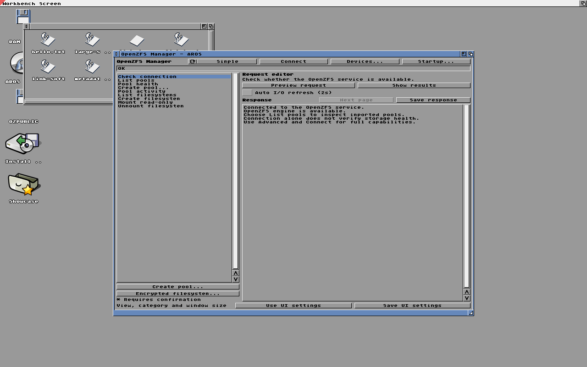
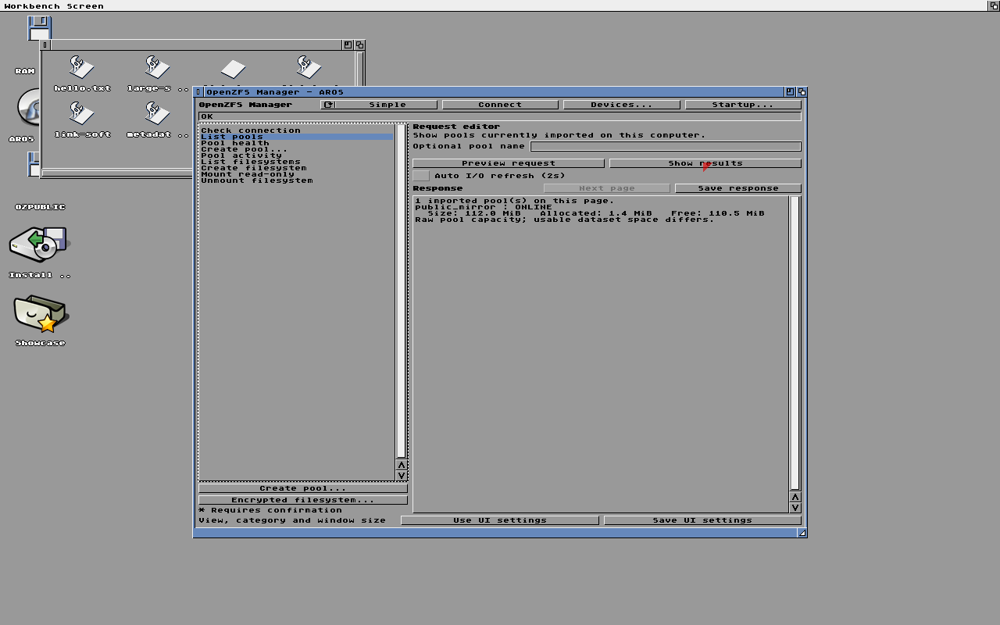
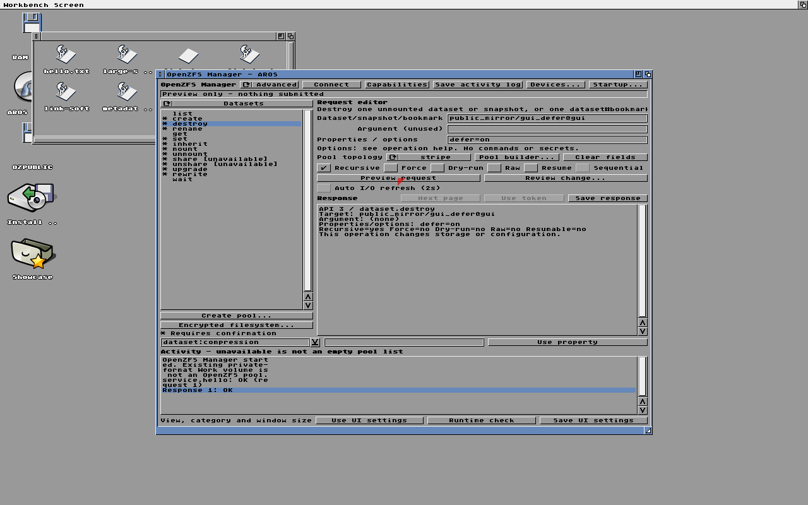
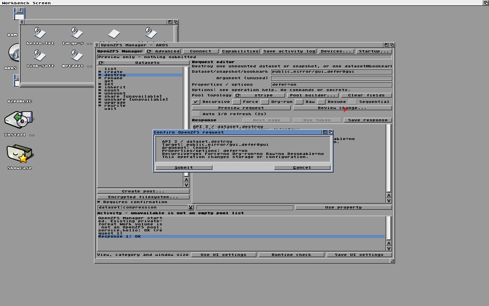
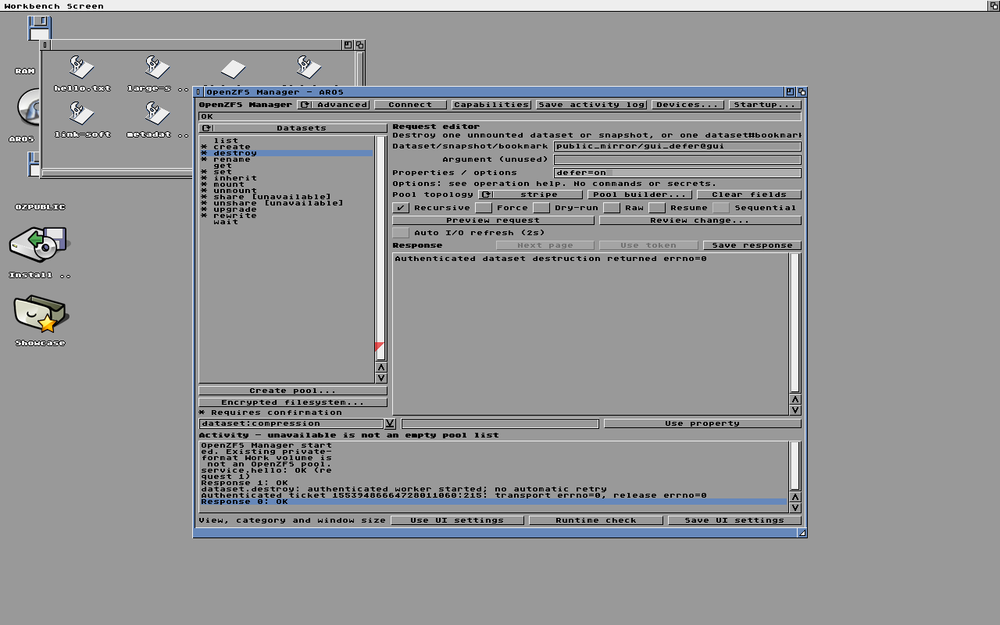

# Native AROS test screenshots

These are unmodified captures from isolated, two-CPU QEMU runs using disposable
storage and explicitly selected patched AROS runtime components. They are not
physical-device qualification or a claim of stock-nightly compatibility.

Each directory retains the serial log, source revision and working-tree patch,
input binary hashes, QEMU version, and ISO-pruning record from that same run.
Absolute paths in the manifests identify the original local inputs; the binary
images themselves are deliberately not stored in Git. A source revision alone
does not describe a run when `source.patch` is nonempty. See
[build and test details](../../../BUILDING.md) for the harness configuration.

## Clone properties through Manager

Run: `native-gui-run.A56TMiQN`. The request creates
`public_mirror/gui_clone` from `public_mirror/files@gui_clone` with
`compression=off;quota=32M;mountpoint=none`.

The response reports upstream exit zero. Separately, after Manager closes,
the test queries origin, quota, compression and unmounted state, then removes
the fixture. The accompanying [serial log](manager-clone/serial.log) records
`Public GUI clone PASS quota=1 compression=1 no-mount=1 origin=1 cleanup=1`
and the final mirror/DOS/read-only-reimport PASS. This capture predates the
later delegated-user test; it does not depict delegation or every property.

## Live pool-directory updates in Wanderer

Run: `native-gui-run.wdcMRy2K`. An already-open pool drawer updates after shell
creation and deletion of `OZPUBLIC:LiveRefresh`, without reopening the drawer.

The [serial log](wanderer-refresh/serial.log) retains the post-UI storage checks.
These images show native desktop integration, not a guarantee of all desktop
workflows. The initial drawer-title defect visible in this run remains a
separate limitation; screenshots have not been retouched to hide it.

## Adding evidence

### Refreshed native package

Run `native-gui-run.HtAMyLoU` tests the refreshed MetaMake command binaries
and Manager against the selected shared engine. The live query reports
`public_mirror` ONLINE, and Wanderer shows the mounted dataset's files.

The matching [serial log](package-refresh/serial.log) records post-UI exact
file readback and the final storage PASS. Separate persistent run
`public-service-run.iFt6XMEu` passes cold healthy/degraded/restored imports,
trusted ENVARC startup restoration, unchanged member hashes and independent
`zdb` verification. Package staging matches binary hashes across both runs.
The earlier `native-gui-run.mh139zIJ` passed its GUI test but omitted desktop
mode; the packager rejected it for lacking post-UI filesystem verification.
That rejected attempt was retained locally and was not used to qualify the
package. See BUILDING.md for the immutable archive identity.

### Clean engine GUI qualification

`native-gui-run.KQyxomdW` uses the cleanly rebuilt shared engine, not the older
candidate shown in the preceding screenshots. Its
[serial log](fresh-engine-gui/serial.log) contains the post-UI exact-read and
storage PASS results. Package staging checks this run's binary identities
against the matching cold-import run. See [engine build notes](../../engine/BUILDING.md)
for the immutable archive hash and runtime prerequisites.

The garbled drawer title is a known, separately tracked limitation, not a
successful title-rendering test.

### Mounted-root identity

`public-service-run.YcFEA8Za` tests the clean engine with additional native
DOS assertions: `Examine` returns the mounted volume's name and `NameFromLock`
returns its colon-terminated root path. These assertions run before directory
enumeration; the full storage suite passes. The retained
[serial results](root-identity/serial-results.log), source patch and input hashes
identify the tested binaries. Its disposable ISO was pruned (4.57 GiB).
Persistent repeat `public-service-run.1LNWGDML` also passes fresh healthy,
degraded and restored mirror imports, exact DOS readback and unchanged pool
member checks. Its [cold results](root-identity/cold-results.log) retain the
post-import directory assertions; these are virtual disks, not hardware proof.
This is not proof that the automatic drawer title is fixed: see the
[separate lifetime investigation](../../handler/drawer-title-investigation.md).

### Evidence retention policy

`destroy-preview` retains `public-service-run.IliFjbsQ`: the actual asynchronous
worker executes upstream destruction dry-run and returns both recursive
snapshot names, while independent queries show unchanged deferred state and
hold count. Invalid flags are refused and the full storage suite passes. This
is API/worker evidence, not a screenshot or GUI interaction test.

`gui-deferred` records `native-gui-run.RFfSUBE5`: actual Manager entry,
preview, confirmation and submission of recursive deferred destruction.
The [serial log](gui-deferred/serial.log) independently verifies parent removal,
held-child retention, removal on release, cleanup and post-UI exact file reads.

`defer-manager` records `native-gui-run.jDpBYxhs` using shared engine
`scTORDPP` and the rebuilt Manager. The live query reports the pool ONLINE;
post-UI exact DOS readback and the full storage suite pass. The known automatic
drawer-title issue remains separate. This captures query/display integration,
not GUI submission of the new recursive deferred-destruction operation.

`cold-release` retains the three-phase native run `public-service-run.fkCVCuGC`:
writer, unchanged read-only cold imports, then a separate writable cold boot.
Authenticated recursive hold release removes both deferred snapshots; export
and read-only reimport confirm their absence, unrelated DOS data remains exact,
and host `zdb` reports no leaks. This is not abrupt-power-loss testing. Two
earlier ISO construction failures are retained as `initial-pack.log` and
`repeat-pack.log`; neither reached the writable test phase.

`pending-defer-cold` retains `public-service-run.no4FZbtl`: recursive deferred
parent/child snapshots survive fresh healthy/degraded/restored imports with
their holds intact. Read-only release fails without changing reference counts;
all pool-member byte checks and host `zdb` pass. The retained writer and cold
logs, source patch and input hashes identify the exact tested code. No writable
cold-release or GUI-interaction claim is made by this fixture.

`recursive-defer` retains the native API results, source patch and binary
identities from `public-service-run.rlEPj1HF`. The freshly rebuilt shared engine
passes recursive deferred snapshot destruction and the full mirror storage
suite. Read the [serial results](recursive-defer/serial-results.log) for the
held/unheld lifecycle and rejected-input checks. No GUI capture is implied.
Persistent repeat `public-service-run.OwggK2Ne` passes the same writer fixture
and fresh healthy/degraded/restored mirror imports, exact file readback,
unchanged pool members and independent host `zdb`. The deferred snapshots are
released and cleaned up during the writer fixture; this is not a test of a
pending hold surviving reboot. Cold results and input hashes are retained here.

`recursive-defer-auth` retains the corrected native delegation run
`public-service-run.JqZeMvsx` (full storage PASS), while
`recursive-defer-auth-initial` retains the failed local-only-grant assumption
from `public-service-run.3LRx0YnK`. The initial denial was correct upstream
behavior, not a driver crash or permission bypass. See the engine README for
the exact grant/revocation assertions.

The `fresh-engine` directory retains the writer/cold-import logs and hashes for
`public-service-run.KKc6pmMp`, using the clean source engine build described in
[engine build notes](../../engine/BUILDING.md). This is a non-GUI test; the
screenshots above must not be treated as captures of that new engine candidate.

Commit selected PNG captures with the matching run identity, relevant logs,
source changes and input hashes when qualifying a new visible behavior. Explain
what is visible and what was verified independently. Do not commit test ISOs,
VM disks, executables, credentials or private user data. Keep original full
captures locally; do not substitute reconstructed illustrations for test output.
